<div align="center">

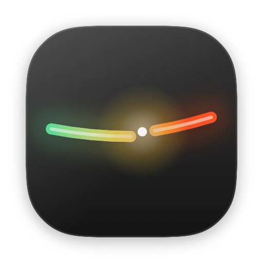

# burnfuse

**A spend breaker for your AI keys.**

Watch the burn rate. Cap the damage. Know within a minute — not in the morning.

A real macOS app. Sits in your Dock and your menu bar.

[The app](#the-app) · [How it works](#how-it-works) · [What a trip cannot do](#what-a-trip-cannot-do) · [Insights](#insights) · [Providers](#providers) · [Privacy](#privacy)

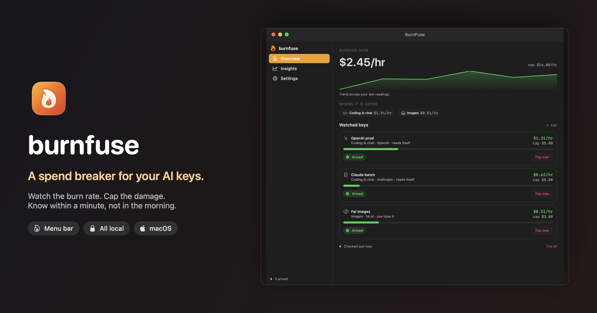

</div>

---

## The problem

A retry loop, a missing `try/catch`, a stuck job. It happens on a Friday night when
nobody is watching. Your AI provider keeps answering, the meter keeps running, and the
billing email shows up in the morning — hours after the money is gone.

BurnFuse watches the meter. When a key burns past the cap you set, or jumps far above
its normal rate, it **trips**: the key is marked, the minute is logged, and you are told
— menu bar red, a notification, and a webhook if you added one. Hearing about it in a
minute instead of in the morning is the whole product.

It is not a dashboard you have to remember to open. It lives in your menu bar as a
single colour block that reads at a glance — green when settled, amber as burn climbs,
red the moment the breaker trips. Click it and you get a miniature of the app: the same
live number, the same watch list, without leaving what you were doing.

The menu bar isn't a menu — it's the app, shrunk. Live burn, the trend, every watched key
and the one action that matters, all in one small panel:

<p align="center">
  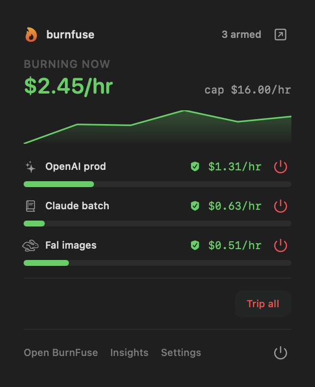
  &nbsp;
  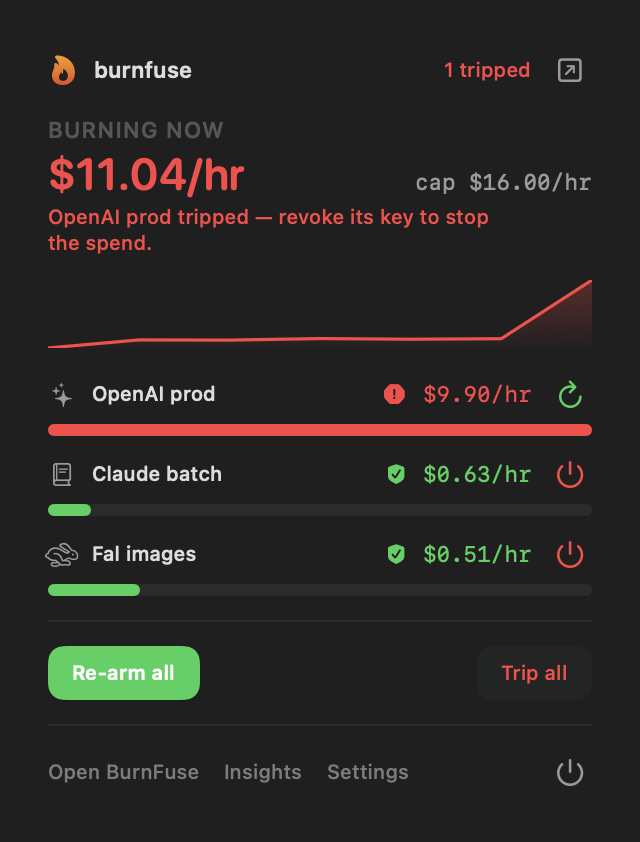
</p>

And the colour block itself, in each state:

<p align="center">
  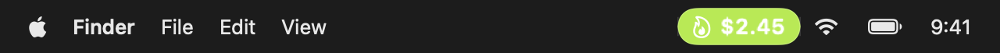
  <br>
  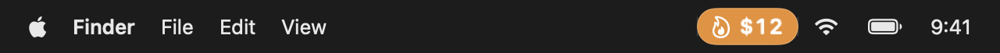
  <br>
  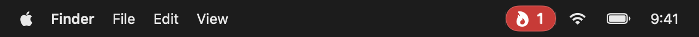
</p>

## What it does

- **Shows the burn.** One number in your menu bar, in a colour block that reads at a glance: green when settled, amber as it climbs, red when tripped.
- **Uses the key you already have.** Paste it once and BurnFuse watches that same key — no second key to create, no list to reconcile. Where a provider needs a particular *kind* of key to read spend, the row says so in one line instead of leaving you to guess.
- **Catches the spike.** It learns each key's normal rate and trips when the rate jumps — even if you never set a cap.
- **Respects the cap.** Set an hourly ceiling per key. Cross it and the breaker trips.
- **Tells you inside a minute.** Menu bar red, a desktop notification, and — if you add one — a Slack or Discord ping. Not a billing email you read tomorrow.
- **States its own limits.** Reading a cost figure and revoking a credential are different permissions. So BurnFuse never claims to have cut a key it cannot cut: every trip names the console page where that key is revoked, because revoking it is what actually stops the billing.
- **Tells you after.** Spending is only half the story. Insights shows every trip and what it was on track to spend.

## The app

BurnFuse is a single window. Everything lives behind the sidebar — your keys, what every
trip was on track to spend, and how the app keeps itself current. No scattered windows,
no submenus.

<p align="center">
  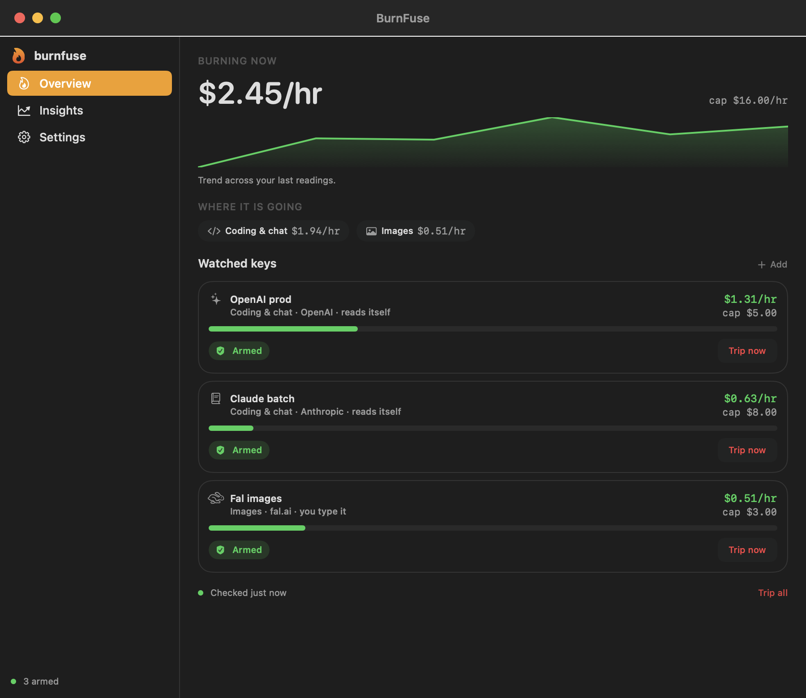
</p>

Light and dark follow the system:

<p align="center">
  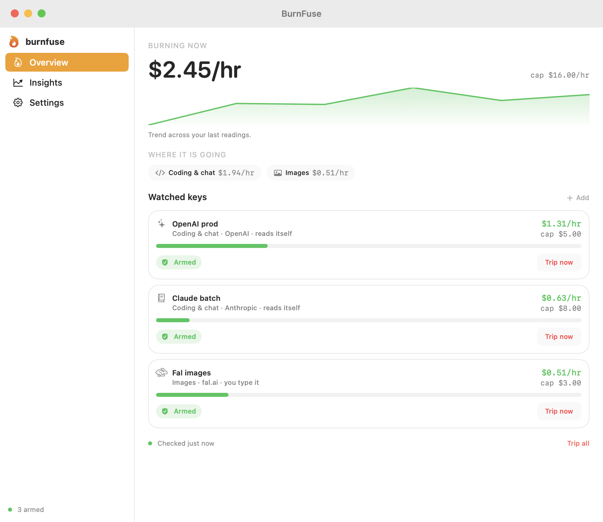
</p>

### Keys

Settings is one list, and the top of that list is where a key goes. Paste the key you
already use — BurnFuse watches that same key. Nothing to create first, no second key to
copy, no separate place to register anything.

As you paste, BurnFuse names the provider from the shape of the key itself (`sk-or-…` is
OpenRouter, `sk-ant-…` is Anthropic), files it under what you use it for, and tells you in
one line what it will be able to do — before anything is saved. Every row then says where
its own number comes from:

| On the row | What it means |
|---|---|
| **reads itself** | BurnFuse reads the provider's own cost figure every minute, with the key you pasted |
| **you type it** | That provider publishes no spend figure — the row takes a number from you, and says where to read it |

A row is a key and a cap. Give it an hourly ceiling, and choose whether BurnFuse should
stop reading a key once it trips — the number then freezes where it tripped, as evidence,
until you re-arm it. What it will not do is pretend to revoke your key: only the provider
can, and every trip says exactly where.

<p align="center">
  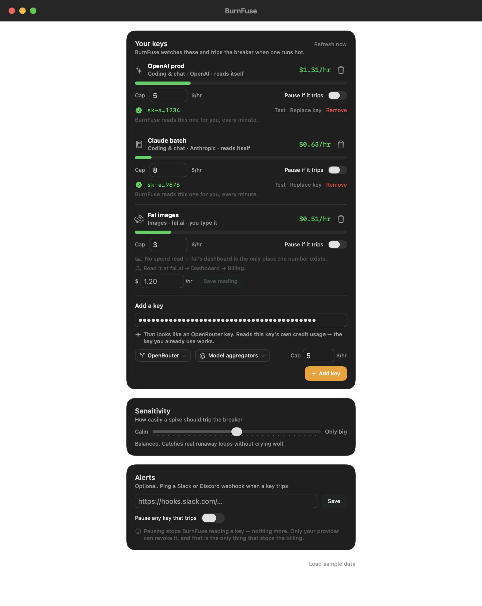
</p>

### Keeping it current

BurnFuse gets a key's spend one of three ways, and the row always says which:

1. **It reads itself.** Paste the key you already use. OpenRouter answers a standard key
   with its own credit usage; OpenAI and Anthropic answer with your organization's costs,
   which their cost APIs accept only from an Admin key — the row says so in one line.
   A failed read gives the provider's own reason rather than a status code: a standard
   OpenAI key instead of an Admin one, or an OpenAI key pasted into the OpenRouter row, is
   named where you typed it rather than failing silently a minute later. A value that is
   really the placeholder from a sample file is called out as one. Keys are stored on your
   Mac only, owner-readable, and are sent nowhere except that provider; the row shows just
   the two ends of the key (`sk-o…0000`), so you can tell which one is stored without it
   being usable. **Test** asks the provider right then, instead of waiting a minute to
   find out.
2. **You type it.** Most providers publish no spend figure at all. Their rows say so in
   plain words and take a number from you — what that key is spending per hour. That is
   all a reading is: one dollar figure per hour. A typed row is a first-class way to use
   the app, not a failure state.
3. **Your own endpoint.** Any URL that returns a dollar amount. Name where the figure
   sits in the JSON, and say whether it counts up.

If a provider turns the key down for cost reads — the common case being a standard OpenAI
key, which can use the API but cannot see spend — the same row offers the way out in
place: **Type this key's spend by hand instead**. The key stays watched either way; only
where the number comes from changes. And a key you have never pasted is never reported as
invalid: the app says it has nothing to read with, which is a different problem from a key
that was turned down. Saving an empty field will not quietly delete a key you already
have — removing one is its own button, on purpose.

Some providers count money up instead of reporting an hourly figure. Those need two reads
— the first saves a baseline, the next one gives you a rate — and the app says so while it
is measuring, rather than showing a number it cannot back up.

A key whose spend has never been measured shows **no reading yet** rather than `$0.00/hr`.
Printing a zero it has not measured would be telling you something it does not know.

## How it works

Two rules, both easy to reason about:

1. **The cap.** You set `$5/hr`. Spend `$5.01` and the breaker trips.
2. **The spike.** BurnFuse keeps your recent hourly readings and works out your normal
   rate. A reading far above that trips the breaker on its own — so a key you never
   capped still gets caught. The interface shows this as a multiple ("4× usual"), not a
   statistic.

You control how easily a key trips. Slide toward *Calm* to catch small jumps, or *Only
big* to hear from BurnFuse only when something is genuinely on fire.

A reading has to be both clearly abnormal *and* worth your attention. Quiet keys with
tiny numbers are not allowed to cry wolf.

When something trips, the window says so plainly — what happened, what BurnFuse did
about it, and the one action that actually ends the spend:

<p align="center">
  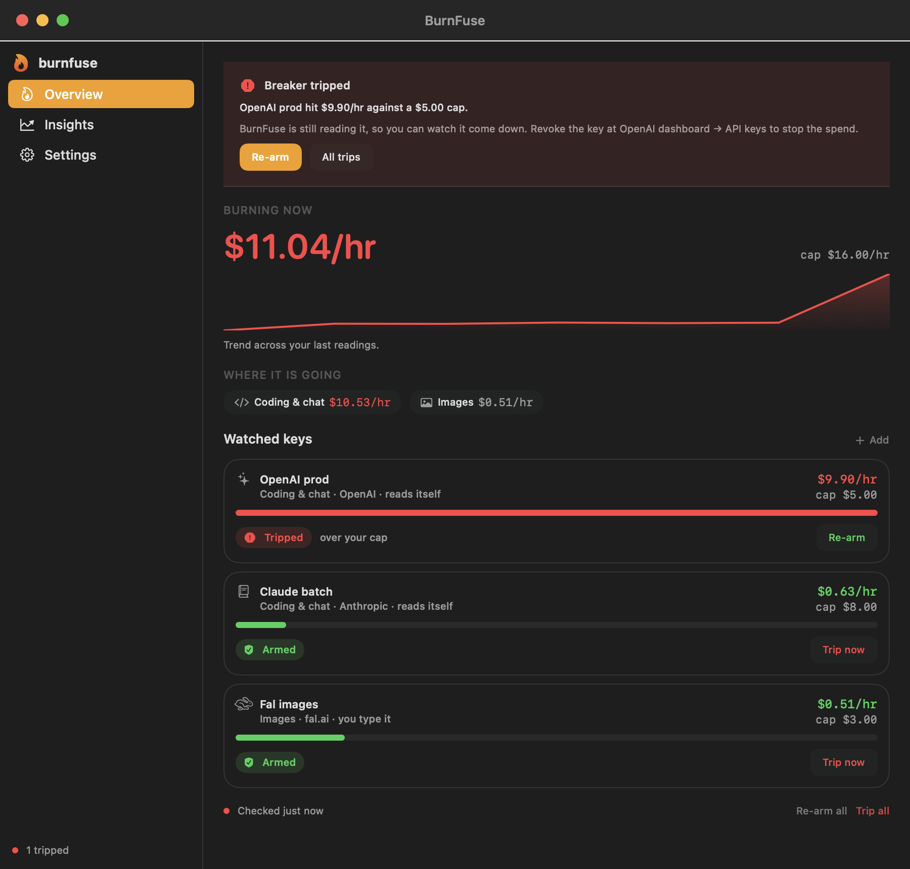
</p>

### What a trip cannot do

Worth being exact about, because "spend breaker" suggests more than any watcher can do:

| On a trip | |
|---|---|
| Marks the key, logs the minute, shows it in the list | yes |
| Menu bar red, desktop notification, optional Slack/Discord ping | yes |
| Stops reading the key, if you asked it to | yes — the number freezes as evidence |
| Revokes the key at the provider | **no** — and it will not imply otherwise |

BurnFuse reads a cost figure with a read-only key. Revoking a credential is a different
permission, and an app holding revocation rights over your keys would be a bigger risk
than the leak it watches for. So instead of pretending it cut something, it points
precisely — *OpenAI dashboard → API keys*, *Claude Console → API keys*, *OpenRouter →
Settings → Keys* — in the banner, the notification and the webhook alike, so whoever
sees it first knows what to do.

The money is saved when you revoke the key. BurnFuse's job is to make that happen in a
minute rather than tomorrow morning.

## Insights

What did the breaker actually save you? Insights adds up what each trip was on track to
spend — the rate it tripped at, held for the next four hours — and frames it as an
estimate rather than money in the bank. The honest framing that billing emails arrive
late is the reason the app exists.

<p align="center">
  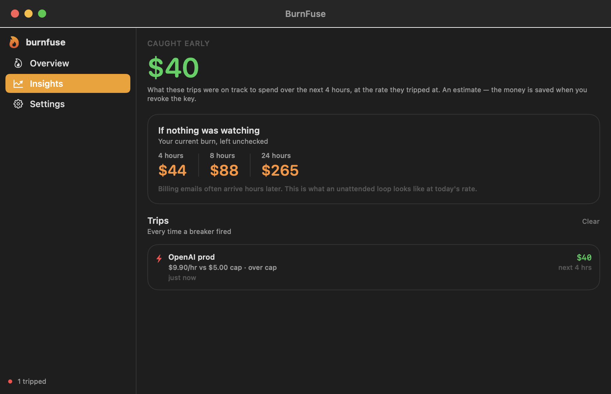
</p>

## Providers

Categories are how the app talks about your spend: the headings when you add a key, and
the breakdown on Overview — *Coding & chat $1.94/hr · Images $0.51/hr*. They organise;
they never decide what BurnFuse can read. That is a fact about the provider, and the
provider says it in one line.

| Category | Reads itself | You type it |
|---|---|---|
| Coding & chat | OpenAI · Anthropic | Google Gemini · xAI · Mistral · DeepSeek · Groq · Together · Fireworks · Perplexity |
| Model aggregators | OpenRouter | Replicate · Hugging Face |
| Images | — | Stability AI · fal.ai |
| Video | — | Runway · Luma |
| Voice & audio | — | ElevenLabs · Deepgram |
| Scraping & search | — | Firecrawl · Apify · Browserbase · Exa · Tavily |
| Hosting & storage | — | AWS · Google Cloud · Azure · Cloudflare · Vercel · Supabase |
| Something else | Your own endpoint | any provider — name it and type its spend |

That is thirty providers by name, and BurnFuse can read spend for three of them — plus any
endpoint of your own. The rest genuinely publish no cost figure that a key can read, and
no amount of wanting changes that. So each row says so, names where the number lives
instead, and takes it. Nothing in the list is ever a dead end.

## Install

### Requirements

macOS 14+ and the Xcode command line tools. No dependencies, no project file.

```bash
git clone https://github.com/Ravinder82/burnfuse.git
cd burnfuse
./scripts/install.sh
```

That builds BurnFuse, drops it in **/Applications**, and opens it. From then on it is a
normal macOS app — launch it from Launchpad, Spotlight (⌘-Space) or the Dock, no terminal
needed:

<p align="center">
  
</p>

Prefer to do it by hand? Build the bundle and copy it wherever you like:

```bash
./scripts/build-app.sh
open macos/build/BurnFuse.app        # or drag it into /Applications
```

### Using it

BurnFuse opens to the full window — Overview, Insights and Settings behind the sidebar,
exactly like any other Mac app. It also keeps a live item in your menu bar:

- **Click the colour block** for a panel: live burn, the trend, every watched key.
- **Right-click it** for the quick actions: open the window, trip every key, quit.
- `⌘,` opens Settings, `⌘I` opens Insights, `⌘W` closes the window (BurnFuse keeps
  running in the menu bar; click the Dock icon to bring it back).

## Privacy

BurnFuse is built to be boring about your secrets.

- **Nothing leaves your machine.** No account, no analytics, no telemetry, no server of ours.
- **Your keys stay local.** Provider keys live in `~/.burnfuse/keys.json`, owner-readable,
  and are sent only to the provider you named, over TLS. Nothing is proxied anywhere.
- **One file holds your data.** `~/.burnfuse/state.json` is the whole product's memory:
  your keys, their readings, and every trip. Delete it and BurnFuse forgets everything.

## Design

Native SwiftUI, following Apple's Human Interface Guidelines: semantic system colours
that respect light and dark, real Dynamic Type, status conveyed by icon *and* colour,
and motion that yields to Reduce Motion.

Every image in this README is a render of the shipping UI — see
[`scripts/screenshots.sh`](scripts/screenshots.sh).

## Development

```bash
./scripts/verify.sh               # tests + app build + launch smoke test
./scripts/build-app.sh            # build the app bundle
./scripts/build-app.sh debug      # faster debug build
./scripts/install.sh              # build + install into /Applications + launch
./scripts/package.sh              # build a double-clickable BurnFuse.dmg
./scripts/screenshots.sh          # regenerate the README and marketing images
```

Tests individually:

```bash
swift test --package-path macos   # burn engine + app model + state contract
```

Run the app from source:

```bash
swift run --package-path macos BurnFuse
```

Layout:

```
macos/               Swift package: the app
  Sources/BurnFuse/       entry point, menu-bar item
  Sources/BurnFuseUI/     window, panel, design system, burn engine, live spend
  Sources/burnfuse-shots/ icon + screenshot + marketing renderer
scripts/             build, install, package, verify and screenshot scripts
assets/              app icon, window screenshots and the marketing card
```

> Building under `~/Desktop` or `~/Documents`? Those folders are iCloud-synced, and
> iCloud writing to build artifacts mid-build makes SwiftPM fail intermittently. The
> scripts already build into `~/Library/Caches/burnfuse-build` to avoid it. Override with
> `BURNFUSE_SCRATCH` if you want it somewhere else.

## License

[MIT](LICENSE) © Ravinder Poonia

<div align="center">
<sub>Built to be quiet, honest, and right the one time it matters.</sub>
</div>