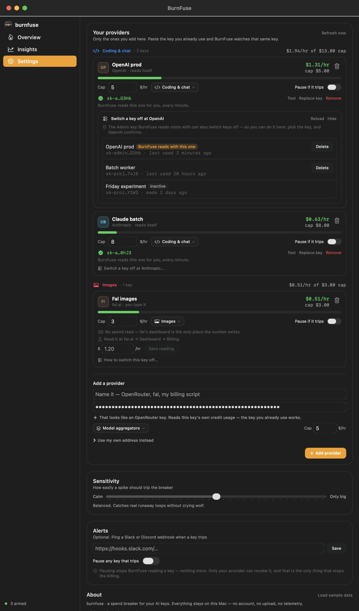

<div align="center">


# burnfuse

**A spend breaker for your AI keys.**

Watch the burn rate. Cap the damage. Know within a minute — not in the morning.

A real macOS app. Sits in your Dock and your menu bar.

[What it does](#what-it-does) · [Your providers](#your-providers) · [How it works](#how-it-works) · [Install](#install) · [Privacy](#privacy)


<p align="center">
  <video width="760" controls autoplay muted loop playsinline poster="assets/window-overview-dark.png">
    <source src="assets/tour.mp4" type="video/mp4">
    Your browser does not support the video tag.
  </video>
  <br>
  <sub>The product tour: the burn block, watched keys, and a trip in under a minute.</sub>
</p>

</div>

---

A retry loop, a missing `try/catch`, a stuck job. It happens on a Friday night when nobody
is watching. Your provider keeps answering, the meter keeps running, and the billing email
shows up in the morning — hours after the money is gone.

BurnFuse watches the meter. When a key burns past the cap you set, or jumps far above its
normal rate, it **trips**: the key is marked, the minute is logged, and you are told — menu
bar red, a notification, and a Slack or Discord ping if you added one. Hearing about it in a
minute instead of in the morning is the whole product.

## What it does

- **Shows the burn.** One colour block in your menu bar: green when settled, amber as it
  climbs, red when tripped. Click it for a miniature of the app without leaving your work.
- **Watches the keys you already have.** Nothing to create first. Add a provider, paste the
  key you use, and BurnFuse watches that same key.
- **Catches the spike as well as the cap.** It learns each key's normal rate and trips when
  the rate jumps — even where you never set a ceiling.
- **Tells you inside a minute.** Menu bar red, a desktop notification, and an optional
  webhook. Not a billing email you read tomorrow.
- **Reads what can be read, and says what cannot.** Three of the providers people use most
  publish a spend figure a key can call; for everything else the row takes a number you type,
  and names the page it lives on.
- **Switches a key off, where it is allowed to.** Where the provider's own API lets the key
  BurnFuse already holds disable a key, the row does it — with a second press first. Where it
  does not, it says why and names the console page instead of pretending. It never claims a
  key is stopped before the provider has said so.
- **Tells you after.** Insights shows every trip and what it was on track to spend.

## The app

One window, everything behind the sidebar. Light and dark follow the system.

<p align="center">
  
  <br>
  
</p>

The menu bar isn't a menu — it's the app, shrunk. The panel opens without taking your focus,
so clicking the item shows the burn over whatever you are doing.

<p align="center">
  
  &nbsp;
  
</p>

## Your providers

**Settings holds only the providers you created.** There is no catalogue to pick from and
nothing to classify first. You name one — *OpenRouter*, *fal*, *my billing script* —
paste the key you already use, and say which pile its spend belongs to. Everything else is
worked out from what you gave:

| On the row | What it means |
|---|---|
| **reads itself** | BurnFuse reads a dollar figure every minute — from the provider's own cost API, where it has one, or from an address you gave |
| **you type it** | Nothing can be read there, so the row takes a number from you and names where to read it |

Naming helps when the key itself says nothing: type *fal* and BurnFuse knows where fal's
number lives and which pile it belongs in. Paste a key it recognises and it says what it is
before anything is saved — `sk-or-…` is OpenRouter, which answers a standard key with its own
credit usage; `sk-ant-…` is Anthropic, and a *cost* read needs an Admin key, which the row
says in one line.

Anything that returns a dollar figure can be a provider: give it an address, where in the
JSON the number sits, and whether it counts up. Your own script, a cloud billing export, a
page behind a token — all of them read themselves, every minute.

Providers are grouped by what you use them for, and every provider is its own card. Each card
leads with the letters of the name you gave it, in that name's own colour, so *OpenAI prod*
and *OpenAI test* are two squares rather than one. The category is a menu on the card, so a
provider filed in the wrong pile can be moved without re-adding it.

<p align="center">
  
</p>

Where a provider counts tokens — OpenAI and Anthropic do — the watch list shows today's input
and output for that key, because a runaway loop is a token count before it is a bill.
Overview's tokens card adds the cached share, a part of In rather than a fourth number, and
nothing there is ever estimated from a price list. OpenRouter reports credits rather than
tokens, so its keys show none, and the card says exactly that.

## How it works

Two rules, both easy to reason about:

1. **The cap.** You set `$5/hr`. Spend `$5.01` and the breaker trips.
2. **The spike.** BurnFuse keeps your recent readings and works out your normal rate. A
   reading far above that trips the breaker on its own, so a key you never capped still gets
   caught. The interface shows this as a multiple — *4× usual* — never as a statistic.

A reading has to be both clearly abnormal *and* worth your attention, so quiet keys with tiny
numbers cannot cry wolf. Slide the sensitivity toward *Calm* to catch small jumps, or *Only
big* to hear from BurnFuse only when something is genuinely on fire.

<p align="center">
  
</p>

A trip marks the key, logs the minute and tells you. It does not by itself stop the money:
only the provider can, by revoking or disabling the key. BurnFuse offers that action exactly
where the credential it already holds is allowed to take it — OpenAI and Anthropic, where
your organisation's cost report is Admin-only and the same Admin key can switch a key off —
and everywhere else it names the console page instead. If you switch off the very key
BurnFuse reads with, it says so in that row, because the readings stop with it.

<p align="center">
  
</p>

## Insights

What did the breaker actually save you? Insights adds up what each trip was on track to spend
— the rate it tripped at, held for the next four hours — and frames it as an estimate rather
than money in the bank.

<p align="center">
  
</p>

## Install

macOS 14+ and the Xcode command line tools. No dependencies, no project file.

```bash
git clone https://github.com/Ravinder82/burnfuse.git
cd burnfuse
./scripts/install.sh
```

That builds BurnFuse, drops it in **/Applications**, and opens it. From then on it is a
normal macOS app — launch it from Launchpad, Spotlight (⌘-Space) or the Dock, no terminal
needed. Or build the bundle and copy it wherever you like:

```bash
./scripts/build-app.sh               # → macos/build/BurnFuse.app
```

### Using it

- **Click the colour block** for a panel: live burn, the trend, every watched provider.
- **Right-click it** for the quick actions: open the window, trip every key, quit.
- `⌘,` opens Settings, `⌘I` opens Insights, `⌘W` closes the window (BurnFuse keeps running in
  the menu bar; click the Dock icon to bring it back).

## Privacy

BurnFuse is built to be boring about your secrets.

- **Nothing leaves your machine.** No account, no analytics, no telemetry, no server of ours.
- **Your keys stay local.** They live in `~/.burnfuse/keys.json`, owner-readable, and go only
  to the provider or the address you pointed them at, over TLS. Removing a provider removes
  the key it was using.
- **One file holds your data.** `~/.burnfuse/state.json` is the whole product's memory:
  your providers, their readings, and every trip. Delete it and BurnFuse forgets everything.

## Design

Native SwiftUI, following Apple's Human Interface Guidelines: semantic system colours that
respect light and dark, real Dynamic Type, status conveyed by icon *and* colour, and motion
that yields to Reduce Motion.

The mark is the app's own idea drawn in the app's own colours: the filament of a fuse that
has just given way — calm green at the tail, climbing amber, and the red past the break —
with the spark the break throws. Like everything else here it is drawn from shapes rather
than shipped as an image, so the Dock icon, the mark in the sidebar, the menu-bar panel and
the marketing card are one drawing at different sizes, and cannot drift apart.

Every image in this README and in [MARKETING.md](MARKETING.md) is a render of the shipping
UI — see [`scripts/screenshots.sh`](scripts/screenshots.sh).

## Development

```bash
./scripts/verify.sh               # tests + app build + launch smoke test
./scripts/build-app.sh            # build the app bundle
./scripts/build-app.sh debug      # faster debug build
./scripts/install.sh              # build + install into /Applications + launch
./scripts/package.sh              # build a double-clickable BurnFuse.dmg
./scripts/screenshots.sh          # regenerate the README and marketing images
swift test --package-path macos   # burn engine + app model + state contract
swift run --package-path macos BurnFuse   # run from source
```

```
macos/               Swift package: the app
  Sources/BurnFuse/       entry point, menu-bar item and its panel
  Sources/BurnFuseUI/     window, panel content, design system, burn engine, live spend
  Sources/burnfuse-shots/ icon + screenshot + marketing renderer
scripts/             build, install, package, verify and screenshot scripts
assets/              app icon, window screenshots and the marketing card
```

> Building under `~/Desktop` or `~/Documents`? Those folders are iCloud-synced, and iCloud
> writing to build artifacts mid-build makes SwiftPM fail intermittently. The scripts already
> build into `~/Library/Caches/burnfuse-build` to avoid it. Override with
> `BURNFUSE_SCRATCH` if you want it somewhere else.

## License

[MIT](LICENSE) © Ravinder Poonia

<div align="center">
<sub>Built to be quiet, honest, and right the one time it matters.</sub>
</div>
