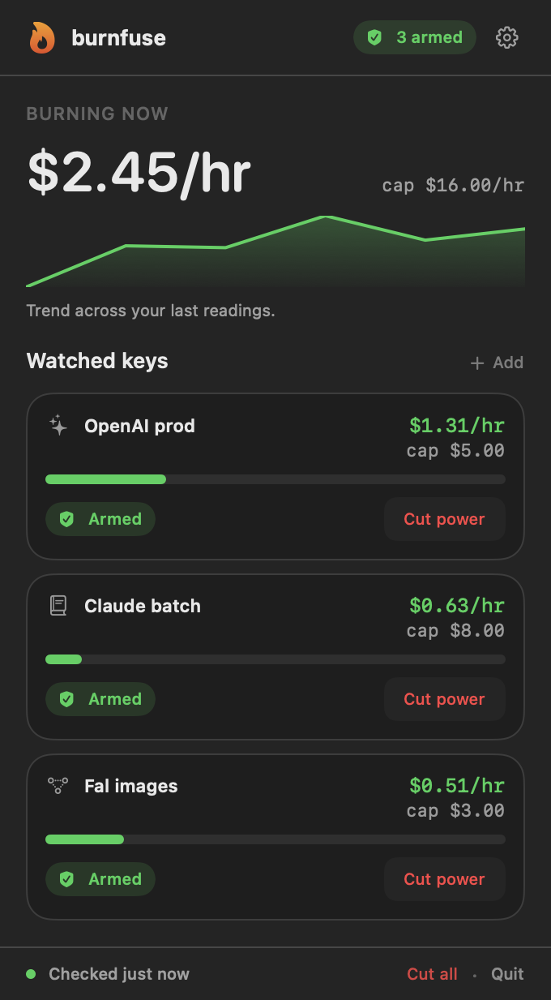
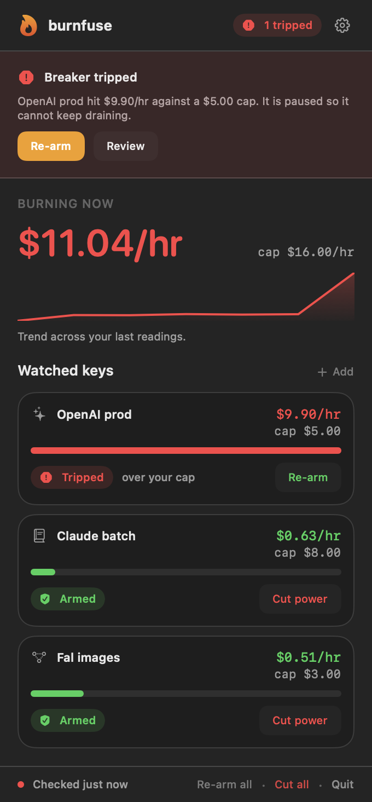
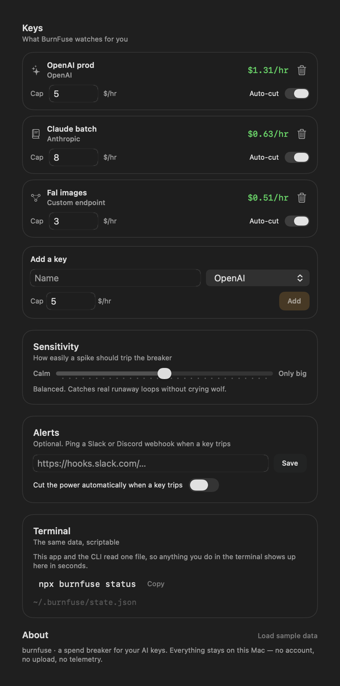
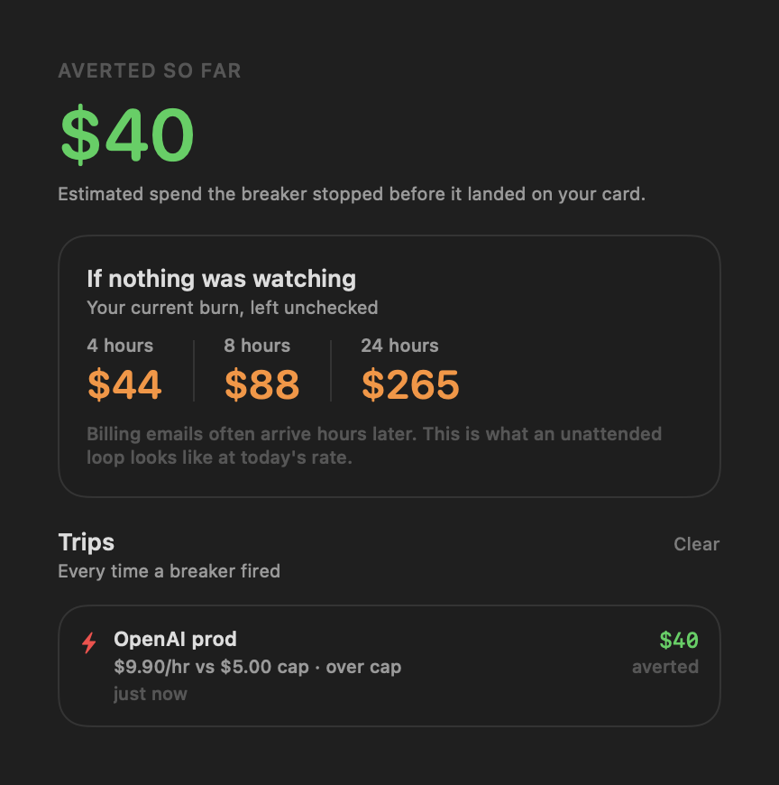

<div align="center">


# burnfuse

**A spend breaker for your AI keys.**

Watch burn rate. Cap the damage. Cut the power before a runaway loop drains your card.

[macOS app](#the-macos-app) · [CLI](#the-cli) · [How it works](#how-it-works) · [Privacy](#privacy)

</div>

---

## The problem

A retry loop, a missing `try/catch`, a stuck job. It happens on a Friday night when
nobody is watching. Your AI provider keeps answering, the meter keeps running, and the
billing email shows up in the morning — hours after the money is gone.

BurnFuse watches the meter. When a key burns past the cap you set, or jumps far above
its normal rate, it **trips** — the key is marked and held before it can keep draining.

It is not a dashboard you have to remember to open. It sits in your menu bar and tells
you the truth in one line.

<p align="center">
  
</p>

## What it does

- **Shows the burn.** One number in your menu bar: what your keys are spending per hour, right now.
- **Catches the spike.** It learns each key's normal rate and trips when the rate jumps — even if you never set a cap.
- **Respects the cap.** Set an hourly ceiling per key. Cross it and the breaker trips.
- **Cuts the power.** One click pauses everything. Auto-cut is there for when you are asleep.
- **Tells you after.** Spending is only half the story. Insights shows what the breaker stopped.

When something trips, the app says so plainly and gives you the one action that matters:

<p align="center">
  
</p>

## Install

### The macOS app

Requires macOS 14+ and Xcode command line tools. No dependencies, no project file.

```bash
git clone https://github.com/Ravinder82/burnfuse.git
cd burnfuse
./scripts/build-app.sh
```

Then open it:

```bash
open macos/build/BurnFuse.app        # or: cp -R macos/build/BurnFuse.app /Applications/
```

It launches straight into the menu bar. There is no dock icon and no window to babysit.
`⌘,` opens settings.

### The CLI

The terminal tool needs nothing but Node 18+.

```bash
npx burnfuse scan                     # find AI keys in your .env files (read-only)
npx burnfuse status                   # see burn rate, caps and spikes at a glance
npx burnfuse add "OpenAI prod" --limit 5
npx burnfuse record openai_prod 1.20  # log an hourly reading
npx burnfuse watch                    # keep watching until something trips
```

Or install it globally:

```bash
npm install -g burnfuse
```

> Not published to npm yet? Run it straight from the repo: `cd cli && node bin/burnfuse.js status`

## The same data, two front doors

The app and the CLI read **one file**: `~/.burnfuse/state.json`. Add a key in the
terminal, it appears in the menu bar within seconds. Trip a breaker in the app, the CLI
sees it immediately. There is no account and no sync service in the middle.

```
┌──────────────┐        ~/.burnfuse/state.json        ┌──────────────┐
│  burnfuse    │  ◀────────────  one file  ──────────▶ │  menu bar    │
│  (terminal)  │                                       │  app         │
└──────────────┘                                       └──────────────┘
```

## How it works

Two rules, both easy to reason about:

1. **The cap.** You set `$5/hr`. Spend `$5.01` and the breaker trips.
2. **The spike.** BurnFuse keeps your recent hourly readings and works out your normal
   rate. A reading far above that trips the breaker on its own — so a key you never
   capped is still protected. The interface shows this as a multiple ("4× usual"), not a
   statistic.

You control how easily a key trips. Slide toward *Calm* to catch small jumps, or *Only
big* to hear from BurnFuse only when something is genuinely on fire:

<p align="center">
  
</p>

A reading has to be both clearly abnormal *and* worth your attention. Quiet keys with
tiny numbers are not allowed to cry wolf.

## Insights

What did the breaker actually save you? Insights adds it up — every trip, what it would
have cost, and the honest framing that billing emails arrive late.

<p align="center">
  
</p>

## The CLI at a glance

```
EVERYDAY
  status                 see every key, burn rate and spike at a glance
  scan [dir] [--import]  find AI keys in your .env files (read-only)
  add <name> [--limit N] [--provider p]   start tracking a key
  record <key> <$/hr>     log an hourly spend reading
  check [key|all]         evaluate now, trip if the breaker should
  poll [key|all]          pull live spend where the provider allows

CONTROL
  trip <key|all>         cut the power now
  arm <key|all> [--clear]   re-arm after a fix
  cap <key> <$/hr>       set the hourly ceiling
  sensitivity <number>    how big a spike trips the breaker (default 2.5)
  watch [--interval 60] [--once]   keep watching until something trips
```

`status` reads like this:

```
  Burn  ▂▂▂▃▃▃█
  ⛔ 1 tripped  ·  2 armed  ·  $11.04/hr burning now

  KEY                       BURN          CAP       STATE
  OpenAI prod               $9.90/hr      $5.00     over cap
  Claude batch              $0.63/hr      $8.00     normal
  Fal images                $0.51/hr      $3.00     1.8× usual
```

The exit code is `2` when something is tripped, so you can wire it into CI:

```yaml
- run: npx burnfuse check
```

## Providers

| Provider | Live spend | How |
|---|---|---|
| OpenAI | ✅ | Organization costs API (needs an Admin key) |
| OpenRouter | ✅ | Reads your credit usage with a standard key |
| Custom endpoint | ✅ | Point it at any URL that returns a dollar amount |
| Anthropic · Replicate · Groq · AWS | — | Log readings, or wire a custom cost endpoint |

Anything without a public spend endpoint still works — `burnfuse record` takes an hourly
number from wherever you already read it (Cost Explorer, a webhook, your own script).

## Privacy

BurnFuse is built to be boring about your secrets.

- **Nothing leaves your machine.** No account, no analytics, no telemetry, no server of ours.
- **The app speaks to nothing.** It reads a local file. That is the whole network story.
- **The CLI only calls what you ask it to.** A live poll hits your provider's own cost
  endpoint, over TLS, with your key. Nothing is proxied anywhere.
- **`scan` is read-only.** It reads variable names from local `.env` files and prints a
  masked preview. Your keys are never printed and never uploaded.

## Design

Native SwiftUI, following Apple's Human Interface Guidelines: semantic system colours
that respect light and dark, real Dynamic Type, status conveyed by icon *and* colour,
and motion that yields to Reduce Motion.

Every image in this README is a render of the shipping UI — see
[`scripts/screenshots.sh`](scripts/screenshots.sh).

## Development

```bash
./scripts/verify.sh               # tests + app build + launch smoke test
./scripts/build-app.sh            # build the app bundle
./scripts/build-app.sh debug      # faster debug build
./scripts/screenshots.sh          # regenerate the README images
```

Tests individually:

```bash
cd cli && node --test             # CLI engine + parsing
swift test --package-path macos   # burn engine + app model + CLI interop
```

Run the app from source:

```bash
swift run --package-path macos BurnFuse
```

Layout:

```
cli/                 the npm package (zero dependencies, Node 18+)
macos/               Swift package: app, shared UI, screenshot tool
  Sources/BurnFuse/       the menu-bar app
  Sources/BurnFuseUI/     views, design system, burn engine
  Sources/burnfuse-shots/ icon + screenshot renderer
scripts/             build, verify and screenshot scripts
assets/              app icon and the screenshots used above
```

The burn-rate math lives in exactly two places — `cli/src/stats.js` and
`macos/Sources/BurnFuseUI/Engine.swift` — and both suites pin the same behaviour, so the
two front doors agree. `macos/Tests/.../InteropTests.swift` decodes a real file written
by the CLI, so the shared-state contract cannot silently break.

> Building under `~/Desktop` or `~/Documents`? Those folders are iCloud-synced, and
> iCloud writing to build artifacts mid-build makes SwiftPM fail intermittently. The
> scripts already build into `~/Library/Caches/burnfuse-build` to avoid it. Override with
> `BURNFUSE_SCRATCH` if you want it somewhere else.

## License

[MIT](LICENSE) © Ravinder Poonia

<div align="center">
<sub>Built to be quiet, honest, and right the one time it matters.</sub>
</div>